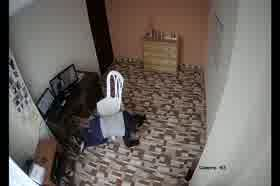
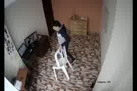
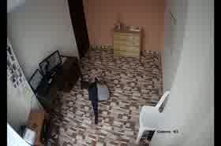

# CAUCAFall replay of the shipped fall rule

Eraso, Muñoz, Muñoz, Pinto, Universidad del Cauca / Universidad de la Amazonia. CAUCAFall, Mendeley Data, V5, DOI 10.17632/7w7fccy7ky.5. CC BY 4.0. The same recordings are described in Eraso et al., Data in Brief 45 (2022) 108610.

This is an offline check of the rule already in `FallDetector`, not a training run and not a change to the app. Pose landmarks were estimated with the same lite model and the same confidence options as `PoseReader`. The yes/no decision, the delay, and the threshold sweep were produced by calling that Kotlin class.

## What was run

Videos used: **100** (50 falls, 50 ADLs) from **10** subjects. Source rate about 20.00 fps, frame size 720×480. Analysis frames were sampled at 5 fps and scaled to fit inside 640×480 (640×427 here) without stretching. PNG frames from the archive were not downloaded; the `.avi` and the per-frame YOLO labels were.

The dataset paper describes the camera as 1080×960 at about 23 fps. The files in version 5 probe as the sizes and rates above.

Dataset details.xlsx records the light and, for falls, the distance and an occlusion mark. No visible light (0 lux): Subject.6, Subject.8. Occlusion marked: Subject.3 Fall sitting, Subject.7 Fall right, Subject.7 Fall sitting, Subject.10 Fall left, Subject.10 Fall right, Subject.10 Fall sitting. Marked camera-to-fall distances run from 2.27 m to 3.43 m.

The shipped rule fires only when all of the following hold: the smoothed shoulder/hip center drops by at least 0.18 of the frame inside about 800 ms, the torso was at least 58° from horizontal at the start of that window, the torso is then within 28° of horizontal, and it stays inside 0.035 of the frame for 2000 ms. Joints are smoothed (alpha 0.55). A torso joint that disappears is held for 1200 ms. One visible shoulder and one visible hip are enough.

Fall onset is the first frame whose YOLO label is `fall`. The dataset authors marked that class only when the body is on the ground because of a fall, so the delay includes the rule's 2000 ms stillness hold. It is not the time from the first loss of balance.

1 video has a label-file count that differs from the probed video frame count by more than 3. Onset time for that clip is less exact.

## Headline

- Fall detection: **4.0% (2/50)**.
- ADL false alarms: **0.0% (0/50)**.
- Sitting false alarms: **0.0% (0/10)**. Kneeling false alarms: **0.0% (0/10)**.
- Median delay from the on-ground label to detection: **2950 ms** (+950 ms relative to the 2000 ms stillness hold) over 2 timed detections.

## Falls by type

| Fall | Detected | Median delay (ms) |
| --- | --- | --- |
| Forward | 0.0% (0/10) | — |
| Backward | 0.0% (0/10) | — |
| Left | 10.0% (1/10) | 2600 |
| Right | 0.0% (0/10) | — |
| From sitting | 10.0% (1/10) | 3300 |

## Daily activities

| Activity | False alarms |
| --- | --- |
| Walking | 0.0% (0/10) |
| Hopping | 0.0% (0/10) |
| Picking up an object | 0.0% (0/10) |
| Sitting | 0.0% (0/10) |
| Kneeling | 0.0% (0/10) |

## By subject

| Subject | Falls detected | ADL false alarms |
| --- | --- | --- |
| Subject.1 | 20.0% (1/5) | 0.0% (0/5) |
| Subject.2 | 20.0% (1/5) | 0.0% (0/5) |
| Subject.3 | 0.0% (0/5) | 0.0% (0/5) |
| Subject.4 | 0.0% (0/5) | 0.0% (0/5) |
| Subject.5 | 0.0% (0/5) | 0.0% (0/5) |
| Subject.6 | 0.0% (0/5) | 0.0% (0/5) |
| Subject.7 | 0.0% (0/5) | 0.0% (0/5) |
| Subject.8 | 0.0% (0/5) | 0.0% (0/5) |
| Subject.9 | 0.0% (0/5) | 0.0% (0/5) |
| Subject.10 | 0.0% (0/5) | 0.0% (0/5) |

## Why falls were missed

48 fall videos did not fire. The blocker is whichever single shipped threshold, when relaxed on its own inside the real detector, turns that video into a detection. Pose measurements under the reason are descriptive; they are not a second detector.

In 17 misses the shoulder–hip axis is still steeper than 60° when the torso center is lowest in the frame. From an upper corner, a person lying along the camera's line of sight keeps that axis steep, so the near-horizontal check never starts. 24 misses are within 28° of horizontal on two or fewer sampled frames. A large raw drop and a flat raw angle on different frames do not satisfy the rule: both have to hold on the smoothed pose, after an upright start, and then the 2000 ms stillness hold.

| What blocked the shipped rule | Misses |
| --- | --- |
| Loose thresholds still do not see a fall | 22 |
| No single threshold; a looser combination would fire | 18 |
| Drop slower than the 800 ms window | 3 |
| Drop smaller than 0.18; also drop slower than the 800 ms window | 2 |
| No usable torso pose | 2 |
| Drop smaller than 0.18 | 1 |

- **Loose thresholds still do not see a fall** (22): `s01_forward` (Fall forward, camera-to-fall distance in the dataset sheet is 2.69 m; torso never lies flat (minimum angle 67°, threshold 28°); longest gap without a torso is 1400 ms, past the 1200 ms grace); `s01_left` (Fall left, camera-to-fall distance in the dataset sheet is 2.85 m; torso never lies flat (minimum angle 67°, threshold 28°)); `s02_forward` (Fall forward, camera-to-fall distance in the dataset sheet is 2.62 m; at the lowest torso center the axis is still 81° from horizontal; torso is within 28° of horizontal on 2 sampled frames); `s03_from_sitting` (Fall sitting, the dataset marks this clip as occluded; camera-to-fall distance in the dataset sheet is 3.34 m; raw torso drop inside 800 ms peaks at 0.04, under 0.18; torso never lies flat (minimum angle 35°, threshold 28°); longest gap without a torso is 2800 ms, past the 1200 ms grace; the pose usually disappears after the body reaches its lowest point).
- **No single threshold; a looser combination would fire** (18): `s01_backward` (Fall backwards, camera-to-fall distance in the dataset sheet is 3.05 m; raw torso drop inside 800 ms peaks at 0.08, under 0.18); `s01_right` (Fall right, camera-to-fall distance in the dataset sheet is 3.41 m; at the lowest torso center the axis is still 83° from horizontal); `s02_backward` (Fall backwards, camera-to-fall distance in the dataset sheet is 3.23 m; raw torso drop inside 800 ms peaks at 0.15, under 0.18; torso is within 28° of horizontal on 2 sampled frames); `s02_from_sitting` (Fall sitting, camera-to-fall distance in the dataset sheet is 2.63 m; raw torso drop inside 800 ms peaks at 0.11, under 0.18; torso is within 28° of horizontal on 2 sampled frames).
- **Drop slower than the 800 ms window** (3): `s05_from_sitting` (Fall sitting, camera-to-fall distance in the dataset sheet is 2.45 m; raw torso drop inside 800 ms peaks at 0.15, under 0.18); `s09_right` (Fall right, camera-to-fall distance in the dataset sheet is 2.72 m); `s10_right` (Fall right, the dataset marks this clip as occluded; camera-to-fall distance in the dataset sheet is 2.95 m).
- **Drop smaller than 0.18; also drop slower than the 800 ms window** (2): `s07_backward` (Fall backwards, camera-to-fall distance in the dataset sheet is 2.63 m); `s07_right` (Fall right, the dataset marks this clip as occluded; camera-to-fall distance in the dataset sheet is 2.53 m; raw torso drop inside 800 ms peaks at 0.15, under 0.18).
- **No usable torso pose** (2): `s08_forward` (Fall forward, recorded with no visible light (0 lux), so the camera is on IR; camera-to-fall distance in the dataset sheet is 2.47 m; a shoulder and a hip are visible on only 0/31 sampled frames); `s08_right` (Fall right, recorded with no visible light (0 lux), so the camera is on IR; camera-to-fall distance in the dataset sheet is 3.40 m; a shoulder and a hip are visible on only 0/57 sampled frames).
- **Drop smaller than 0.18** (1): `s09_backward` (Fall backwards, camera-to-fall distance in the dataset sheet is 2.91 m; raw torso drop inside 800 ms peaks at 0.16, under 0.18).

## Threshold sweep

Each one-parameter table changes only that field of `FallConfig` and leaves the others at the shipped values. The grid behind the recommendation also crosses minDrop, lie angle, stillness movement, and drop window. Nothing here is written back into the app.

Every row in this sweep, including the grid, has 0 ADL false alarms. Inside the ranges searched, loosening these four fields did not make walking, hopping, picking up, sitting, or kneeling fire, and it still left most falls undetected. These tables do not locate the false-alarm boundary of a closer, side-on phone view.

### minDrop

| minDrop | Falls detected | ADL false alarms | Sitting FA | Kneeling FA | Median delay (ms) |
| --- | --- | --- | --- | --- | --- |
| 0.08 | 10.0% (5/50) | 0.0% (0/50) | 0/10 | 0/10 | 2600 |
| 0.10 | 8.0% (4/50) | 0.0% (0/50) | 0/10 | 0/10 | 2500 |
| 0.12 | 8.0% (4/50) | 0.0% (0/50) | 0/10 | 0/10 | 2500 |
| 0.14 | 4.0% (2/50) | 0.0% (0/50) | 0/10 | 0/10 | 2950 |
| 0.16 | 4.0% (2/50) | 0.0% (0/50) | 0/10 | 0/10 | 2950 |
| 0.18 (shipped) | 4.0% (2/50) | 0.0% (0/50) | 0/10 | 0/10 | 2950 |
| 0.22 | 0.0% (0/50) | 0.0% (0/50) | 0/10 | 0/10 | — |
| 0.26 | 0.0% (0/50) | 0.0% (0/50) | 0/10 | 0/10 | — |
| 0.30 | 0.0% (0/50) | 0.0% (0/50) | 0/10 | 0/10 | — |

### Torso lie angle (maxLieAngleDeg)

| maxLieAngleDeg | Falls detected | ADL false alarms | Sitting FA | Kneeling FA | Median delay (ms) |
| --- | --- | --- | --- | --- | --- |
| 18 | 2.0% (1/50) | 0.0% (0/50) | 0/10 | 0/10 | 3300 |
| 22 | 2.0% (1/50) | 0.0% (0/50) | 0/10 | 0/10 | 3300 |
| 28 (shipped) | 4.0% (2/50) | 0.0% (0/50) | 0/10 | 0/10 | 2950 |
| 35 | 4.0% (2/50) | 0.0% (0/50) | 0/10 | 0/10 | 2950 |
| 42 | 4.0% (2/50) | 0.0% (0/50) | 0/10 | 0/10 | 2950 |
| 50 | 4.0% (2/50) | 0.0% (0/50) | 0/10 | 0/10 | 2950 |

### stillMovement

| stillMovement | Falls detected | ADL false alarms | Sitting FA | Kneeling FA | Median delay (ms) |
| --- | --- | --- | --- | --- | --- |
| 0.020 | 4.0% (2/50) | 0.0% (0/50) | 0/10 | 0/10 | 3450 |
| 0.035 (shipped) | 4.0% (2/50) | 0.0% (0/50) | 0/10 | 0/10 | 2950 |
| 0.050 | 4.0% (2/50) | 0.0% (0/50) | 0/10 | 0/10 | 2950 |
| 0.080 | 4.0% (2/50) | 0.0% (0/50) | 0/10 | 0/10 | 2750 |
| 0.120 | 4.0% (2/50) | 0.0% (0/50) | 0/10 | 0/10 | 2750 |

### dropWindowMs

| dropWindowMs | Falls detected | ADL false alarms | Sitting FA | Kneeling FA | Median delay (ms) |
| --- | --- | --- | --- | --- | --- |
| 400 | 0.0% (0/50) | 0.0% (0/50) | 0/10 | 0/10 | — |
| 600 | 2.0% (1/50) | 0.0% (0/50) | 0/10 | 0/10 | 3900 |
| 800 (shipped) | 4.0% (2/50) | 0.0% (0/50) | 0/10 | 0/10 | 2950 |
| 1200 | 6.0% (3/50) | 0.0% (0/50) | 0/10 | 0/10 | 2600 |
| 1600 | 10.0% (5/50) | 0.0% (0/50) | 0/10 | 0/10 | 2700 |
| 2000 | 10.0% (5/50) | 0.0% (0/50) | 0/10 | 0/10 | 2950 |

## Recommended setting

Recommendation rule used on this sweep only: do not add ADL false alarms, do not add sitting or kneeling false alarms, and do not detect fewer falls than the shipped rule. Among settings that pass, prefer more falls, then fewer ADL alarms, then fewer changed fields.

**Suggested for this camera geometry, not applied:** `minDrop=0.10, maxLieAngleDeg=45, stillMovement=0.050, dropWindowMs=1600`. It detects 13/50 falls versus 2/50 shipped, with 0/50 ADL false alarms (sitting 0/10, kneeling 0/10). Confirm on a phone before editing `FallConfig`.

That setting still misses 37 of 50 falls. Changing these thresholds does not make the corner-camera set reliable, and `FallConfig` was left as shipped.

## Example frames

Small JPEG crops from the CC BY 4.0 videos, for the rows above. They are not used by the detector.

Detected fall near the labeled on-ground frame. Subject.1, Fall sitting.

Sitting, an ADL the rule is meant to ignore. Subject.1, Sit down.

Missed fall (Loose thresholds still do not see a fall). Subject.1, Fall forward.

## Limits

The falls are acted by young adults (the dataset paper lists ages 23–40), instructed by a kinesiologist, wearing protective pads. An unwitnessed fall by an older person can look different.

The camera is a fixed HIKVISION sensor in an upper corner, about 2.15 m high. The paper describes 1080×960 at about 23 fps; the version-5 files used here are the sizes and rates above. Some clips are IR with little visible light, with occlusion and people at different distances. The product camera is a phone propped on a table or shelf, usually much closer, at 640×480 analysis, with a ViewPort crop. A drop of 0.18 of the frame is a different physical motion in those two pictures. These counts do not measure on-phone accuracy.

Landmarks come from the Python MediaPipe tasks runtime, not from Android `PoseReader`. The model file, IMAGE mode, one pose, and 0.35 confidence match. Camera rotation, the front-camera mirror, and the FILL_CENTER crop do not run in this harness.

A timeout-worthy detection waits 2000 ms after the lying pose. Clips that end sooner cannot confirm, even when the drop and the angle were right. Delay is measured from the on-ground label, so a median near 2000 ms means the hold, not a late drop.

Not checked here: a physical phone, heat at 640×480, manufacturer background limits, or whether a real resident who stays on the floor matches these acted landings. Thresholds in the app were not changed.
